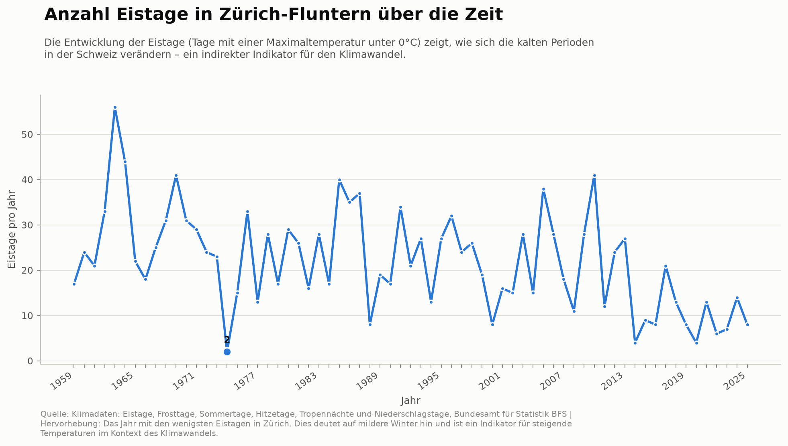
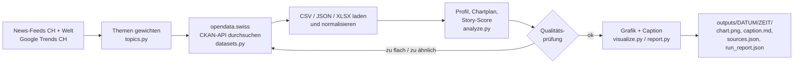
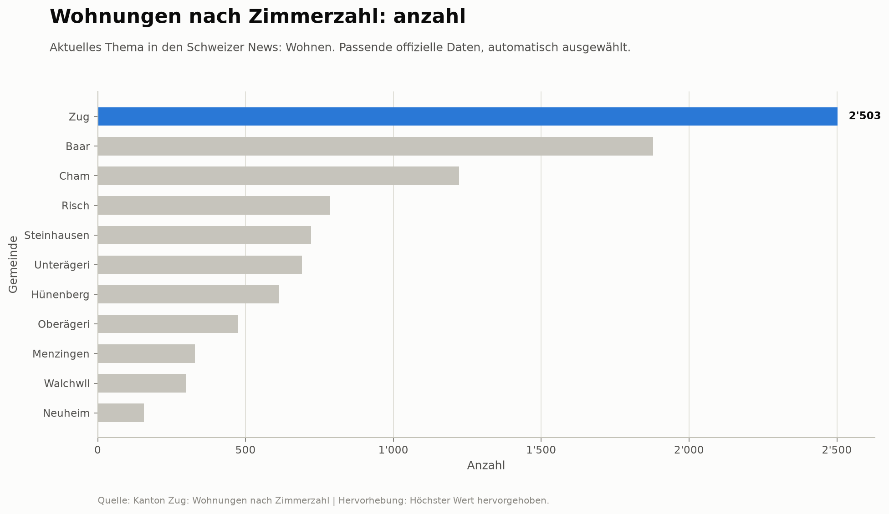

# Swiss Data Story

[](https://github.com/silvancode/swiss-data-story/actions/workflows/tests.yml)


**Findet jeden Morgen ein aktuelles Schweizer Thema, sucht dazu offizielle Daten auf [opendata.swiss](https://opendata.swiss) und erzeugt eine fertige Grafik mit Begleittext und Quellenangabe.**

*Daily pipeline: Swiss news & trends → matching open government data → chart + caption. Python, pandas, matplotlib, optional LLMs with rule-based fallback.*


<sub>Beispiel mit LLM-Chartplan (Titel, Untertitel, Hervorhebung). Daten: BFS via opendata.swiss.</sub>

## Warum

Auf opendata.swiss liegen über 10'000 Datensätze von Bund, Kantonen und Gemeinden, und kaum jemand schaut sie an. Gleichzeitig wird jeden Tag über Mieten, Inflation, Energie oder Klima diskutiert. Das Projekt verbindet beides automatisch: Es fragt «Worüber spricht die Schweiz gerade?» und antwortet mit einer Grafik aus offiziellen Zahlen.

## Wie es funktioniert



1. **Themen sammeln**: RSS von SRF, Watson, 20 Minuten, admin.ch, Google News, BBC sowie GDELT und Google Trends Schweiz. Weltthemen bekommen über eine Themen-Map einen Schweizer Datenwinkel (Inflation → Landesindex der Konsumentenpreise, Krieg → Asylgesuche/Aussenhandel).
2. **Themen gewichten** nach Aktualität und Quellenvielfalt. Themen, die weltweit *und* in der Schweiz trenden, bekommen einen Bonus. Sport und Promi-News ohne Datenbezug werden abgewertet.
3. **Datensätze suchen** über die CKAN-API von opendata.swiss und nach Treffergenauigkeit, Herausgeber (Bund/BFS bevorzugt), Aktualität und ladbaren Formaten ranken.
4. **Daten laden**: Statistik-Excel-Dateien des BFS haben oft mehrzeilige Kopfzeilen und Gruppenüberschriften. `datasets.py` erkennt den Datenbeginn, baut sprechende Spaltennamen und wandelt Zahlen um.
5. **Analysieren**: Spaltenprofil (Zahl / Zeit / Kategorie), Chartplan (10 Diagrammtypen), Story-Score aus Datenqualität, Darstellbarkeit, Themen- und Datensatzrelevanz.
6. **Qualität sichern**: Zu wenige Zeilen, flache Kurven oder fehlende Spalten werden verworfen. Stories, die einer früheren zu ähnlich sind (gleicher Datensatz, gleiche Kennzahl, Jaccard-Ähnlichkeit der Begriffe), werden übersprungen.
7. **Ausgeben**: Grafik mit Hervorhebung und Quellenzeile, Caption mit Kernaussagen, Alt-Text und Einschränkungen sowie ein vollständiger `run_report.json` jedes Versuchs.

Ohne KI (reiner Regelmodus) entsteht z. B. diese Grafik zum Nachrichtenthema «Wohnen»:



## Technische Schwerpunkte

| Thema | Umsetzung |
|---|---|
| **KI optional, nie zwingend** | Jeder KI-Schritt (Themen, Datensatz-Ranking, Chartplan, Caption) hat einen regelbasierten Fallback. Ohne API-Key läuft die Pipeline vollständig. |
| **Mehrere LLM-Anbieter** | `AI_PROVIDER=groq,ollama,gemini` ist eine Prioritätenliste. Der erste Anbieter, der antwortet, gewinnt. Groq, Ollama und Hugging Face laufen über *einen* OpenAI-kompatiblen Codepfad (`ai.py`). |
| **Keine erfundenen Aussagen** | `compute_chart_facts` berechnet Rangliste, Extremwerte und Veränderung aus den *geplotteten* Daten. `ground_title` und `ground_annotations` entfernen Superlative («höchste», «Rekord»), die diese Zahlen nicht stützen. |
| **Robustes JSON-Parsing** | Kleine lokale Modelle antworten oft mit Prosa oder Codefences um das JSON. `_parse_json` holt das Objekt trotzdem heraus. |
| **Nachvollziehbarkeit** | Jeder Lauf schreibt alle Versuche mit Grund für Erfolg/Abbruch und alle KI-Fehler in `run_report.json`. |
| **Automatisierung** | GitHub Actions: Unit-Tests + Lint bei jedem Push, Tageslauf um 06:30 UTC mit Ergebnis als Artefakt. Der Story-Verlauf wird zwischen Läufen gecacht. |

## Schnellstart

```bash
git clone https://github.com/silvancode/swiss-data-story.git
cd swiss-data-story
python -m venv .venv && source .venv/bin/activate   # Windows: .venv\Scripts\Activate.ps1
pip install -r requirements.txt
cp .env.example .env        # optional: API-Keys eintragen
python -m src.main
```

Ergebnis:

```text
outputs/2026-11-24/063012/
  chart.png          Grafik
  caption.md         Titel, Beschreibung, Kernaussagen, Einschränkungen, Alt-Text
  sources.json       Datensatz, Ressource, Lizenz, Chartplan
  run_report.json    alle Themen und Versuche inkl. Scores und Abbruchgründen
```

### KI-Anbieter (optional)

| Anbieter | Kosten | Einsatz |
|---|---|---|
| `groq` | gratis (Kontingent) | Entwicklung |
| `ollama` | lokal, gratis (GPU ab ~6 GB VRAM, z. B. `qwen2.5:7b`) | Entwicklung offline |
| `hf` | kleines Gratis-Kontingent | Test |
| `openai`, `gemini` | bezahlt | Produktion |

```text
AI_PROVIDER=groq,ollama     # Groq zuerst, sonst lokales Ollama, sonst Regeln
```

Alle Einstellungen (Schwellenwerte, Anzahl Themen, Timeouts) stehen in [`.env.example`](.env.example).

## Entwicklung

```bash
pip install -r requirements-dev.txt
pytest          # Unit-Tests ohne Netzwerk und ohne KI
ruff check src tests
```

## Projektstruktur

```text
src/
  main.py        Ablaufsteuerung, ein Ausgabeordner pro Lauf
  config.py      Einstellungen aus Umgebung/.env, Feed-Listen
  topics.py      News/Trends holen, Themen extrahieren und gewichten
  datasets.py    opendata.swiss durchsuchen, Ressourcen laden und normalisieren
  analyze.py     Profil, Chartplan, Story-Score, Qualitätsprüfung, Faktenprüfung
  visualize.py   matplotlib-Grafiken (10 Typen) mit Hervorhebung
  report.py      Caption und Ausgabedateien
  history.py     Ähnlichkeit zu früheren Stories
  ai.py          einheitlicher Zugriff auf alle LLM-Anbieter
tests/           pytest-Unit-Tests
```

## Grenzen und nächste Schritte

- Die Pipeline erzeugt **Kandidaten**, sie veröffentlicht nichts automatisch. Aussagen und Kontext sollen vor einer Publikation von einem Menschen geprüft werden.
- Im reinen Regelmodus sind Titel und Themen-Labels noch technisch (Spaltennamen, Stichwortlisten). Mit LLM werden sie deutlich lesbarer.
- Nicht jeder offene Datensatz ist sauber: Ausreisser durch fehlende Werte oder geänderte Einheiten werden noch nicht erkannt.
- Ideen: Ausreisser-Erkennung, statische Galerie der Tages-Stories auf GitHub Pages, Mehrsprachigkeit (DE/FR).

## Daten und Lizenz

Daten: [opendata.swiss](https://opendata.swiss). Es gelten die Nutzungsbedingungen des jeweiligen Datensatzes, die in `sources.json` verlinkt sind.
Code: [MIT](LICENSE).
